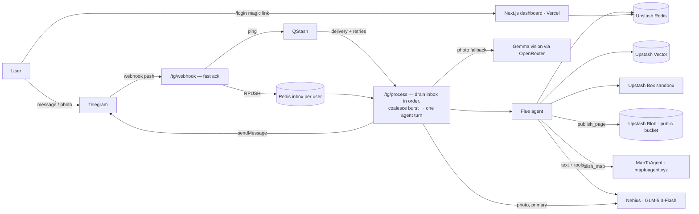

# Calorie Track Agent

A personal health agent that lives in Telegram. Text it what you ate — or send a photo of your plate — and it logs calories and macros, remembers your profile, corrects itself when you push back, and answers questions about your history. A companion web dashboard shows an Apple-Watch-style calorie calendar.

Calorie tracking is the first vertical; the architecture is built to extend into further health domains (biological age, scheduling, coaching).

## What it does

- **Log meals by text or photo.** "I had two eggs" or a photo of the plate → kcal + macro estimate, persisted per user.
- **Photos are classified, not just described.** A plate gets logged; a fridge / freezer / pantry shot is inventoried and remembered (not logged), so "what can I cook from what I sent you?" works hours later; a nutrition label gets its numbers quoted.
- **One reply per burst.** An album of five photos, or "here you go" followed by four pictures, is one agent turn and one answer — not five isolated "that's a freezer, not a plate" replies.
- **Natural corrections.** "That was yesterday, not today" moves the meal and fixes both days' totals. "It's a lentil waffle, not a rice cake" edits in place — no delete-and-relog.
- **Conversational onboarding.** Age / height / weight / activity / allergies gathered chat-first; the daily kcal target is computed (Mifflin-St Jeor) or set explicitly.
- **Proactive feedback.** The agent asks "how did that meal feel?" some time after a log, and records the sentiment on the meal.
- **Assumption ledger.** Inferences the agent makes about you ("tends to skip breakfast") are stored with confidence levels, shown on the dashboard, and confirmable/rejectable.
- **Persistent memory.** One continuous conversation per user, stored in Redis, so it survives deploys and instance restarts; older turns are compacted into a summary once the transcript passes ~60k tokens.
- **A computer of its own.** For tasks no tool covers (compute a weekly average, parse a recipe URL), the agent spins up an ephemeral Linux sandbox (Upstash Box) and runs code. This is the first step toward a general personal agent; persistent browser sessions, credential vaulting, and long-lived workspaces are intentionally separate future capabilities.
- **Pages it publishes for you.** Ask for a trip plan, a weekly meal plan or a shopping list and the agent writes a self-contained HTML page, hosts it on Upstash Blob under your tenant prefix, and sends you the link. "Add day 3" updates the same URL.
- **Maps it publishes for you.** Places (an itinerary, restaurants near the hotel, "what's within 10 min walk of X") become a live interactive map via [MapToAgent](https://maptoagent.xyz): grouped pins, routes per day, walk/bike/drive reach areas. Same link on update.
- **Web dashboard.** Calorie calendar heatmap (deficit/surplus per day), daily progress ring, macro bars, meal log by day, profile + assumptions. Login via a one-time magic link the bot DMs you.

## Architecture



Two deployables, one shared database:

| Piece | Where | What |
|---|---|---|
| **Agent** (`.flue/`, `src/`) | Google Cloud Run, scale-to-zero | Flue server exposing the chat agent + Telegram webhook pipeline |
| **Dashboard** (`dashboard/`) | Vercel | Next.js app reading the same Upstash Redis directly |

The webhook → queue → processor split exists because Telegram requires a fast webhook ack (slow responses cause duplicate redeliveries) while an agent turn takes 5–60s, and Cloud Run's request-based billing only grants CPU *inside* a request. QStash bridges the two: the webhook acks in ~200ms; QStash calls `/tg/process` as a fresh request in which the whole turn runs. Idle = zero instances = zero cost.

### Message ingestion: per-user inbox, one turn per burst

The webhook doesn't hand QStash the update itself. It appends the update to an ordered **Redis inbox per user** (`t:{id}:inbox`) and pings QStash with just `{tenantId, chatId}`. `/tg/process` takes the user's turn lock, **drains the inbox in order**, and coalesces whatever has arrived — an album (Telegram delivers each photo as a separate update), "here all of them" plus four pictures, three rapid texts — into **one agent turn**. It waits ~1.2s after the newest item (2.5s for album photos) so a burst still trickling in lands in the same turn, loops until the inbox is empty, releases the lock, and re-checks the inbox once more so nothing appended during the hand-off is stranded. Items are peeked, processed, then trimmed, so a hard crash leaves them for QStash's retry instead of dropping them.

Why not one QStash job per update with a 429 while busy (the first design): QStash's retry backoff is `e^(2.5·n)` seconds — 12s, 2.5 min, 30 min, 6 h — so a five-photo album came back minutes to hours late, out of order, and sometimes never (retries exhausted). Each photo was also an isolated turn, so the model answered five times and never saw the pictures together.

### iMessage via Photon: same pipeline, second channel

iMessage arrives through [Photon Spectrum](https://photon.codes) managed lines: `/im/webhook` → the same per-user inbox → QStash → `/im/process`. Everything past the webhook is channel-neutral: the drain loop and the agent turn talk back through a `Channel` (`lib/channel.ts`: send text, typing, voice, fetch media), so the transport can later be swapped, e.g. for a self-hosted Mac, without touching the pipeline. iMessage tenants are `im:<handle>` (E.164 number or lowercased email) until linked: Telegram never gives a bot the user's phone number, so `/link` in Telegram asks for it with Telegram's share-contact button, and it counts only when the contact's `user_id` is the sender's own. From then on iMessage from that number lands in the Telegram tenant (`lib/identity.ts`) — one inbox, one session, each turn answered on the channel it came from. `/unlink` undoes it.

Three Photon-specific choices:
- **We verify and enqueue the webhook ourselves** (`verifySpectrumSignature`) instead of using the SDK's `app.webhook()`, whose handler runs *after* the response, when Cloud Run no longer grants CPU.
- **Replies go through the SDK** (gRPC, created lazily in `/im/process`); Spectrum has no HTTP send API. We never read `app.messages`, so webhooks stay the only inbound path.
- **One bubble per reply, no voice replies.** Rapid multi-bubble bursts are the pattern Apple flags as automated, and our TTS is OGG/Opus. Photos arrive as HEIC and are converted to ≤1600px JPEG (`lib/images.ts`); voice memos (AAC/m4a) go to the same STT.

On the free plan, lines are shared and only reach handles added under **Users** in the Photon dashboard (max 10).

### Places: Google Maps lists, Sezar lists, place details

Google has no API that reads or writes a user's Maps lists, so `capabilities/places.ts` works around both directions:
- **Read:** a list shared by link is public. `import_google_maps_list` resolves the link and reads Google's own (undocumented) `entitylist/getlist` JSON, with no browser, no login and no consent interstitial, then keeps each place's name, address, coordinates, CID and the owner's note. The owner's name, avatar and account id in that response are never read. The endpoint is undocumented, so the parser fails loudly on a shape change instead of importing garbage.
- **Write:** Sezar keeps its own lists (`lib/placeLists.ts`, one JSON value per list plus an index for the per-turn context). Getting a place into Google Maps is a link (`?cid=` or `query_place_id`); the user taps Save. Re-importing a link refreshes the same Sezar list.
- **Details:** `place_details` resolves a place with the free IDs-only Text Search, then one Place Details call (rating, price, hours, up to 5 Google reviews), and confirms list matches by CID. Only the place id is stored (Google's caching rules), and reviews stay out of maps (EEA terms since Jul 2025).
- **Taste:** list names and notes feed the assumptions ledger through the persona (`note_assumption`), never Places content.
- **Discovery:** `web_search` (`capabilities/search.ts`, Exa) replaces recommending venues from model memory. When Exa answers with one of its Places pages, a second call fetches that page and `lib/exa.ts` parses each venue (address and coordinates, rating, hours, recent reviews without reviewer names). About $0.008 a search. Queries leave for Exa, so the persona keeps personal and health details out of them.

### Photos: classify, remember, then act

Each photo goes through a vision call that returns a **kind** (`plated_meal`, `packaged_food`, `ingredients_storage`, `menu_or_recipe`, `not_food`) plus a kind-appropriate description — an itemized inventory for a fridge or shelf, portions for a plate, the numbers for a label. Descriptions are stored in a per-user **photo memory** (`t:{id}:photos`, 7 days) and the last 48 hours are injected into every turn's context. That is what makes "what should I cook from what I sent you?" answerable without relying on the model to dig the right turn out of a long transcript.

### Artifacts: pages and maps the agent publishes

Beyond chat replies the agent can hand the user a link — a page it wrote, or a map of places.

**The model writes content, not chrome.** `publish_page` takes a *body fragment*; `lib/pageTemplate.ts` sanitizes it and renders it into the Sezar page shell — wordmark, typography scale, light/dark via `prefers-color-scheme`, print rules, and a house class vocabulary (`.day`, `.stop`, `.stats`, `.kv`, `.note`, `ul.check`, `.cta`) the model composes with. Letting the model invent inline CSS per page produced a different-looking document every time; now the shell owns the design and a page costs ~9 KB with the whole system inlined. Nothing external is fetched, so a page renders the same offline, in an email preview, and saved to PDF. The sanitizer is an allowlist — structural tags, our classes, `http(s)`/`mailto`/`tel` links that get `rel="noopener noreferrer nofollow"` — so scripts, inline styles, iframes, forms and remote images can't reach a published page. Full documents are no longer accepted at all: the shell owns `<head>`, so nothing legitimate needs to live outside the allowlist.

**Storage and tenancy.** Pages land in a **public** Upstash Blob bucket at `p/{sha256(tenant)[:16]}/{slug}-{random}.html`; the hashed prefix keeps the Telegram id out of shared links and the random suffix makes URLs unlisted. A *private* bucket cannot work here: it exposes no public URL, and its signed URLs are capped by the signing credential (measured at ~437s no matter what `expiresIn` asks for), so a link would die minutes after you sent it. On a private bucket `putPage` throws `PrivateBucketError` and the agent falls back to sending the content as a message. `publish_map` posts typed places to [MapToAgent](https://maptoagent.xyz) and returns a hosted map URL. Both hosts are storage only: which user owns what lives in a per-tenant **artifact registry** in Redis (`t:{id}:artifact:*`), the last five ride in each turn's context so "add day 3" becomes an update instead of a duplicate, and the model only ever sees ids from that registry — which is what enforces tenancy.

**Writes are gated and concurrency-safe.** `publish_*`, `update_*` and `delete_artifact` do not act: they stage the rendered draft in Redis and return a one-time token, and only a standalone `/approve <token>` message from the authenticated user within 10 minutes executes it. Model output can therefore never publish by itself. Updates are optimistic-concurrency: `read_artifact` returns the stored page with its etag (or the map with its version) and the update must pass it back, so a revision can't silently clobber a newer one.

### One session per tenant (and the bug that hid it)

Flue keys a session's storage by `[instanceId, harness, sessionName]`, where `instanceId` is the `<id>` segment of the agent URL. The processor used to call `/agents/chat/<telegram update_id>`, so every message opened a brand-new session: the bot had no conversation memory at all (one user had 45 one-turn sessions in Redis), and everything that looked like memory came from the Redis-side context block. The URL now carries the tenant id, so a user has exactly one conversation. Compaction is tuned for chat (`WORKING_CONTEXT_TOKENS` in `lib/models.ts`): the model has a 1M window, but re-sending a huge transcript every Telegram turn is slow and pricey, so older turns are summarised past ~60k tokens with the last 10k kept verbatim.

### Latency: reasoning budget, timeouts, telemetry

GLM-5.3-Flash thinks before it answers; on a map-building turn that was ~3k hidden tokens per model call and the single biggest latency cost (a first trip plan took 321s, past the processor's timeout). Flue registers custom models with `reasoning: false` and never sends an effort level, so `app.ts` adds `reasoning_effort` (env `NEBIUS_REASONING_EFFORT`, default `low`) at the HTTP layer for Nebius chat completions that carry tools; vision calls are exempt because they describe better with thinking on. Timeouts are sized for real turns (agent 480s, drain deadline 60s, lock 600s, all inside Cloud Run's 600s request), and a turn longer than 40s sends a one-line "still working" bubble. Every model call and tool call emits a JSON log line (`llm_turn`, `tool_call`) with duration and token counts, queryable in Cloud Run Logs Explorer.

### Persona in the system prompt

Sezar's voice and standing rules live in `.flue/roles/sezar.md`, a Flue *role* compiled into the build and applied as the system prompt (`init({ role: "sezar" })`). Each turn's user message carries only a small `[context]` block (date, profile, assumptions, most recent logged meal, photo memory) and what the user actually sent. Previously the whole persona was prepended to every user message, so the transcript was ~90% repeated instructions and the model lost track of what the user had sent a few turns back.

## Stack

| Concern | Choice | Why |
|---|---|---|
| Agent harness | [Flue](https://flueframework.com) | Sessions with pluggable persistence, typed tool definitions, structured output enforcement, sandbox abstraction — without renting a hosted agent platform |
| LLM | GLM-5.3-Flash via [Nebius Token Factory](https://tokenfactory.nebius.com) | Fast, multimodal, strong tool-calling, and OpenAI-compatible |
| Vision | GLM-5.3-Flash via Nebius, with Gemma via OpenRouter as fallback | Photo → kind + structured description (inventory / portions / label numbers) feeds the tool-enabled agent turn and the photo memory; Gemma preserves image handling during Nebius vision failures |
| State | Upstash Redis | Meal log, daily totals, profiles, assumptions, photo memory, per-user inbox, sessions, locks — all tenant-prefixed (`t:{telegramId}:*`) |
| Semantic recall | Upstash Vector | "Have I logged eggs this week?" — embeddings per tenant namespace |
| Agent compute | Upstash Box | Ephemeral per-turn Linux sandbox for `run_shell` / `run_code` tools |
| Page hosting | Upstash Blob (**public** bucket) | Pages the agent writes (plans, lists) rendered into the Sezar shell, tenant-prefixed paths, unlisted URLs, updated in place under an etag |
| Search | [Exa](https://exa.ai) | Live place discovery (Exa Places: address, coordinates, hours, reviews) and web search in one API |
| Maps | [MapToAgent](https://maptoagent.xyz) | Typed places in, hosted interactive map URL out; groups, routes, isochrone reach areas; stable URL across updates |
| Channel | Telegram (webhook; [grammY](https://grammy.dev) for local dev) | Free, has photos/voice, and the verified Telegram sender id doubles as the tenant key and dashboard identity; future channels need provider-specific sender verification |
| Queue | Upstash QStash | Reliable "go drain this user's inbox" delivery + retries between webhook ack and agent turn |
| Dashboard | Next.js on Vercel | Server-rendered reads of the shared Redis; zero-config deploys |

## Why TypeScript

1. **The harness decided it.** Flue is a TypeScript framework. Once it was chosen as the agent backbone, the language followed. (The original plan considered Python for Cognee's sake; Cognee was deferred, Flue was not.)
2. **One language, whole system.** Agent tools, webhook pipeline, Telegram integration, and the dashboard are all TS. For a small team that means one mental model, shared conventions, and no serialization seams between "agent land" and "app land".
3. **Types at the boundaries that bite.** Agent systems fail at boundaries: tool parameter schemas, LLM structured output, Redis record shapes. Here those are all typed and validated (TypeBox-style tool params, valibot result schemas, typed record mappers). A missing tool reference or a renamed field is a compile error, not a silent runtime failure mid-conversation.
4. **The ecosystem is TS-first.** grammY, the Upstash SDKs, Next.js, Hono — every dependency in this repo publishes first-class types.

One hard-won caveat lives in `tsconfig.flue.json`: the agent code in `.flue/` is outside the default `src/` include, and `flue build` tolerates unresolved names — so the repo typechecks **both** roots (`npm run typecheck`). Don't trust the bundler alone.

## Repository layout

```
.flue/
  agents/chat.ts      # the agent: per-turn context + 12 tools (log/edit/query meals,
                      #   profile, feedback, assumptions, shell/code sandbox)
  roles/sezar.md      # Sezar's persona + rules → the system prompt (Flue role)
  app.ts              # HTTP surface: Telegram webhook → Redis inbox → QStash →
                      #   drain/coalesce → agent turn; provider registry; wraps Flue's app (Hono)
  capabilities/       # artifacts.ts — page/map tools + the /approve gate
  lib/                # redis (data layer + photo memory + artifact registry), inbox,
                      #   vector, box, vision (classify + describe), pages (Upstash Blob),
                      #   pageTemplate (the Sezar page shell + sanitizer),
                      #   maproom (MapToAgent client), artifactApproval, sessionStore,
                      #   telegramApi, stt, fishAudio, loginToken, message (envelope)
src/                  # local-dev long-polling bot (grammY) — prod uses webhooks
dashboard/            # Next.js dashboard (Vercel) — own package.json
Dockerfile            # single-process container: node dist/server.mjs
deploy-cloudrun.sh    # deploy + `set-webhook` subcommand
```

## Running locally

```bash
npm install
cp .env.example .env   # fill in tokens (see below)
npm run dev            # flue dev server + long-polling bot
```

Requires: a Telegram bot token (@BotFather), Upstash Redis + Vector + Box + QStash credentials, a Nebius API key, an OpenRouter key for vision. Optional: an Upstash Blob token — the bucket **must be public**, a private one has no shareable URL — for `publish_page`, a MapToAgent key for `publish_map` (`POST https://maptoagent.xyz/v1/register`).

**Caveat:** if the production webhook is registered, Telegram sends no updates to a long-poller. Delete the webhook while developing, restore it after:

```bash
curl "https://api.telegram.org/bot$TELEGRAM_BOT_TOKEN/deleteWebhook"
# ...develop...
./deploy-cloudrun.sh set-webhook
```

For the dashboard: `cd dashboard && cp .env.example .env.local && npm install && npm run dev` (a dev-only login bypass exists at `/api/auth/dev?id=<telegramId>`; production auth is the bot's `/login` magic link).

## Deploying

**Agent → Cloud Run** (scale-to-zero):

```bash
gcloud auth login && gcloud config set project <project>
./deploy-cloudrun.sh              # build + deploy
./deploy-cloudrun.sh set-webhook  # first time / after secret change
./deploy-cloudrun.sh imessage-webhook && ./deploy-cloudrun.sh  # iMessage, once: registers /im/webhook with Photon, saves its secret, redeploys
```

**Dashboard → Vercel:** import the repo, set **Root Directory = `dashboard`**, add the env vars, deploy. Then register the domain with @BotFather (`/setdomain`) if you want the Telegram Login Widget in addition to magic links.

## Cost profile

Idle cost is zero (scale-to-zero). Light usage sits inside Cloud Run's request-based free tier and Upstash/Vercel free tiers; the paid LLM is a few cents per hundred turns. The dominant design constraint throughout was: *an agent that costs nothing while nobody is talking to it.*

## Roadmap

- Voice-message logging (transcription → same pipeline)
- Subscription tiers (Stripe) + usage quotas
- Further health domains: biological age, calendar/scheduling, coaching loops
